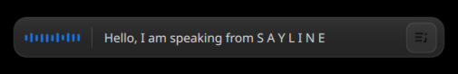

<h1 align="center">
  <a href="https://dhanush-s-gowda.github.io/Sayline/">
    
  </a>
  Sayline
</h1>

<p align="center">
  <strong>Give your keyboard a breather.</strong><br>
  Live, local voice typing for KDE Plasma on Wayland.
</p>

<p align="center">
  <a href="https://dhanush-s-gowda.github.io/Sayline/">
    
  </a>
  &nbsp;
  <a href="#quick-start">
    
  </a>
</p>

<p align="center">
  Press <kbd>Ctrl</kbd> + <kbd>Space</kbd>, speak, and your words appear in the app you're using.<br>
  Powered by NVIDIA Nemotron through NeMo-Speech.cpp, running locally on your computer.
</p>

<p align="center">
  <br>
  <sub>A small, movable overlay that keeps your app in focus.</sub>
</p>

---

## Features

- **Live transcription**: text updates as you speak, with corrections as
  recognition results are refined.
- **Local recognition**: CPU inference with the English `nemotron-en` model.
- **An unobtrusive overlay**: move it where you like while your app keeps
  keyboard focus.
- **Spoken punctuation**: optionally dictate comma, full stop, question mark,
  punctuation marks, symbols, digits, line breaks, and paragraphs. See the full command
  reference below.
- **Desktop integration**: start and stop with a KDE shortcut and revisit
  previous dictation sessions in your history.

## Spoken punctuation and formatting

Click the **punctuation icon** on the dictation overlay to turn spoken commands
on or off. They are **off by default**, and Sayline remembers your setting.
The following English phrases work when this option is on; capitalization does
not matter.

| Say | Output | Spacing |
|---|---|---|
| `comma` | `,` | Attached to the preceding text |
| `full stop` | `.` | Attached to the preceding text |
| `question mark` | `?` | Attached to the preceding text |
| `exclamation mark` | `!` | Attached to the preceding text |
| `colon` | `:` | Attached to the preceding text |
| `semicolon` | `;` | Attached to the preceding text |
| `hyphen` | `-` | Joins adjacent text: `well-known` |
| `em dash` | `—` | Spaces around the dash |
| `ellipsis` | `…` | Attached to the preceding text |
| `apostrophe` | `'` | Joins adjacent text: `it's` |
| `open quote` | `"` | Attached to the text that follows |
| `close quote` | `"` | Attached to the preceding text |
| `open parenthesis` | `(` | Attached to the text that follows |
| `close parenthesis` | `)` | Attached to the preceding text |
| `open bracket` | `[` | Attached to the text that follows |
| `close bracket` | `]` | Attached to the preceding text |
| `forward slash` | `/` | Joins adjacent text |
| `backslash` | `\` | Joins adjacent text |
| `underscore` | `_` | Joins adjacent text |
| `at sign` | `@` | Joins adjacent text: `name@example` |
| `hash sign` | `#` | Attached to the text that follows: `#topic` |
| `percent sign` | `%` | Attached to the preceding text: `50%` |
| `ampersand` | `&` | Spaces around the symbol |
| `new line` or `next line` | One line break | Starts the next line |
| `new paragraph` | Two line breaks | Leaves one blank line |

Number words also become digits when punctuation is **on**:

| Say | Output |
|---|---|
| `zero` | `0` |
| `one` | `1` |
| `two` | `2` |
| `three` | `3` |
| `four` | `4` |
| `five` | `5` |
| `six` | `6` |
| `seven` | `7` |
| `eight` | `8` |
| `nine` | `9` |

For example, `I have two apples` becomes `I have 2 apples`.
`one two three` becomes `1 2 3`; these replacements do not combine digits or
parse larger numbers. Existing numeric text stays unchanged. With punctuation
**off**, Sayline uses the recognizer's default output without replacing number
words; the recognizer may itself produce digits.

For example, say:

```text
Hello comma world full stop next line open quote well hyphen known close quote
```

Sayline inserts:

```text
Hello, world.
"well-known"
```

To type a command as words, say **`literal` before it**: `literal comma` types
`comma`, and `literal new line` types `new line`. `literal two` types `two`.
The escape applies to all supported commands. Bare `period`, `dash`, and `at`
are not command aliases.

Commands update the live transcript as recognition arrives. Turning the option
on or off affects new words; text already dictated keeps its previous formatting.
Sayline inserts line breaks through the clipboard rather than simulating the
Enter key. How multiline pasted text behaves depends on the receiving app.
The overlay displays line and paragraph breaks as spaces to keep its preview on
one line; pasted text retains the requested line and paragraph breaks.
Commands do not change capitalization or correct grammar.

## Quick start

Sayline is tested on **Fedora KDE Plasma 6 / Wayland**. Other distributions can
work with Plasma 6 / KWin on Wayland when they provide Qt 6.7 or newer and the
dependencies below. Their installation paths have not been verified yet.

### Fedora KDE (tested)

```sh
sudo dnf install gcc-c++ cmake qt6-qtbase-devel qt6-qtdeclarative-devel \
  qt6-qtmultimedia-devel qt6-qtwebsockets-devel ydotool wl-clipboard
```

### Debian / Ubuntu KDE

```sh
sudo apt install build-essential cmake qt6-base-dev qt6-declarative-dev \
  qt6-multimedia-dev qt6-websockets-dev qdbus-qt6 plasma-workspace \
  ydotool wl-clipboard
```

Your package sources must provide **Qt 6.7 or newer**. If they provide an older
Qt version, this source will not build without a newer Qt installation.

### Arch Linux KDE

```sh
sudo pacman -S --needed base-devel cmake qt6-base qt6-declarative \
  qt6-multimedia qt6-websockets qt6-tools plasma-workspace ydotool wl-clipboard
```

### Install speech recognition and run

Install NVIDIA's NeMo-Speech.cpp runtime and fetch the model Sayline uses:

```sh
curl -fsSL https://github.com/NVIDIA/NeMo-Speech.cpp/raw/main/scripts/install.sh | sh
export PATH="$HOME/.local/bin:$PATH"
nemo-speech pull nemotron-en
```

From the Sayline repository, build and install the KDE shortcut:

```sh
cmake -S . -B build -DCMAKE_BUILD_TYPE=Release
cmake --build build -j2
./scripts/install-kde.sh
```

The installer configures Sayline under `~/.local`. Press **Ctrl+Space** to
start or stop dictation. It starts and manages its own speech process on port
`18080`; keep that port free and do not start a separate `nemo-speech serve`.
The installer requires an active Plasma session, D-Bus, systemd user services,
`qdbus`, and `kwriteconfig6`. It does not require `sudo`.

Before installing, configure and start `ydotoold` for your distribution and
ensure it can access `/dev/uinput`. Do not run Sayline as root.

## Testing on another KDE distribution

Confirm that the session is Plasma 6 on Wayland and that the installed Qt is
6.7 or newer. Install the packages above using your distribution's package
manager, then build and run the visual preview:

```sh
cmake -S . -B build -DCMAKE_BUILD_TYPE=Release
cmake --build build -j2
./build/sayline --preview
```

The preview checks that the overlay launches; it does not test the microphone,
speech model, shortcut, or text insertion. To exercise those, install the
NeMo-Speech.cpp runtime and model, configure `ydotoold`, then run
`./scripts/install-kde.sh` in the Plasma session. Try dictating into a text
editor and verify that **Ctrl+Space** opens and closes the overlay, live text
arrives, and the intended application keeps focus. Please report the distro and
version, Plasma and Qt versions, and any installer or runtime error when sharing
test results.

## Windows and macOS

Windows and macOS are **not supported**. Sayline currently depends on Linux
Wayland, KWin scripting, D-Bus, `ydotool`, and Linux-specific process handling.
Porting would require replacing those integrations; installing Qt and building
the current source is not sufficient. A future port would also need Qt 6.7+,
CMake 3.21+, and a C++20 compiler, plus platform-specific equivalents for the
desktop integration and input injection.

## Speech recognition credits

The recognition engine and `nemotron-en` model come from NVIDIA's
[NeMo-Speech.cpp project](https://github.com/NVIDIA/NeMo-Speech.cpp); Sayline
provides the KDE interface and integration. Check NVIDIA's project for its
runtime license, notices, and model terms.
